# Data model

This is the target data model from `docs/PLAN.md` §3, drawn as an ER diagram. **Storage is
MongoDB (Atlas)**: each entity is a collection with a string UUID `_id`, and the implemented
document shapes live in `src/lib/server/db/types.ts`, which is the source of truth. Implemented
so far: `organization`, Better Auth's `user`/`session`/`account`/`verification`/`twoFactor`,
`role` (with **embedded** `permissions`, so `role_permission` below is not a separate
collection), `user_role`, `invitation`, `activity_event`, `email_log`, `location`,
`inventory_category`, `item`, `stock_movement`, `attachment`. Everything else is a design
draft. Relationships are plain id fields: there are no foreign keys, so cascades are done in
services.

Money fields are integer minor units + a `currency` code — never floating point.
Most tables also carry `created_at`/`updated_at` (and often `created_by`), omitted below to
keep the diagram legible.

```mermaid
erDiagram
    %% --- Core / platform -----------------------------------------------
    ORGANIZATION {
        int id PK
        text name
        text iban
        text default_currency
        text timezone
        text default_locale
    }
    USER ||--o{ SESSION : has
    USER ||--o{ ACCOUNT : has
    USER ||--o{ TWO_FACTOR : has
    USER ||--o{ USER_ROLE : has
    ROLE ||--o{ USER_ROLE : "assigned via"
    ROLE ||--o{ ROLE_PERMISSION : grants
    USER ||--o{ EVENT_TEAM_MEMBER : "scoped role on"
    ROLE ||--o{ EVENT_TEAM_MEMBER : via
    USER ||--o{ INVITATION : "invited by"
    USER ||--o{ ACTIVITY_EVENT : "acted by"
    USER ||--o{ NOTIFICATION : receives
    USER ||--o{ NOTIFICATION_PREFERENCE : sets

    %% --- Inventory -------------------------------------------------------
    LOCATION ||--o{ LOCATION : "parent of"
    LOCATION ||--o{ ITEM : stores
    INVENTORY_CATEGORY ||--o{ INVENTORY_CATEGORY : "parent of"
    INVENTORY_CATEGORY ||--o{ ITEM : categorizes
    ITEM ||--o{ ITEM_PHOTO : has
    ITEM ||--o{ STOCK_MOVEMENT : "moved via"
    EVENT ||--o{ STOCK_MOVEMENT : "consumed/returned at"

    %% --- Events -----------------------------------------------------------
    EVENT ||--o{ EVENT_TEAM_MEMBER : staffed_by
    EVENT ||--o{ EVENT_BUDGET_LINE : budgets
    EVENT ||--o{ EVENT_CHECKLIST_ITEM : tracks
    EVENT ||--o{ EVENT_MATERIAL_LINE : plans
    ITEM ||--o{ EVENT_MATERIAL_LINE : "reserved as"
    EVENT ||--o{ FINANCE_TRANSACTION : "costs/revenue for"

    %% --- Finance ------------------------------------------------------------
    ACCOUNT ||--o{ FINANCE_TRANSACTION : posts_to
    FINANCE_CATEGORY ||--o{ FINANCE_CATEGORY : "parent of"
    FINANCE_CATEGORY ||--o{ FINANCE_TRANSACTION : categorizes
    FINANCE_TRANSACTION ||--o{ TRANSACTION_ATTACHMENT : has
    ATTACHMENT ||--o{ TRANSACTION_ATTACHMENT : is

    %% --- Contacts & invoices ------------------------------------------------
    CONTACT ||--o{ INVOICE : "billed to"
    EVENT ||--o{ INVOICE : "linked to"
    INVOICE ||--o{ INVOICE_LINE : contains
    INVOICE ||--o{ INVOICE_PAYMENT : "paid via"
    ACCOUNT ||--o{ INVOICE_PAYMENT : receives
    FINANCE_TRANSACTION ||--o{ INVOICE_PAYMENT : records

    %% --- Email ingestion ------------------------------------------------------
    MAIL_ACCOUNT ||--o{ MAIL_MESSAGE : polls
    MAIL_RULE ||--o{ MAIL_MESSAGE : "matched by"
    EVENT ||--o{ MAIL_MESSAGE : "linked to"
```

## Notes

- `finance_transaction` is the single ledger for everything money-related: regular income/
  expense, event external costs, expense reimbursements, and invoice payments all flow through
  it with different `kind`/`category`/`event_id` combinations, rather than duplicating the
  money model per feature (see `docs/PLAN.md` §4).
- `attachment` is generic/polymorphic (`entity_type` + `entity_id`), used by item photos,
  transaction receipts, invoices, event covers, etc. — `transaction_attachment` above is shown
  as its own join for clarity since transactions commonly have several.
- Full column-level detail (types, defaults, constraints) lives in
  `src/lib/server/db/schema/*.ts` once each module is implemented — that's the source of truth,
  not this diagram or `docs/PLAN.md` §3.
